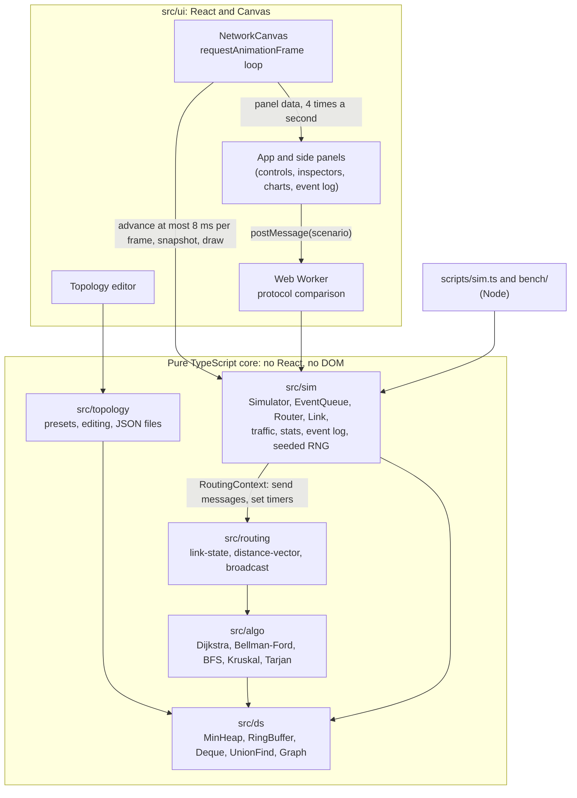
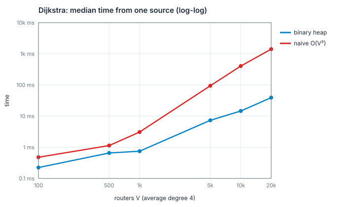
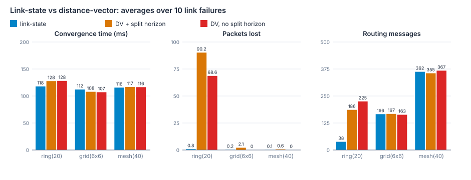

# Real-Time Network Routing Simulator

[](https://github.com/its-harsh-here/Network-Routing-Simulator/actions/workflows/deploy.yml)

**Build a network, cut a link, and watch link-state and distance-vector routing reconverge live:
a discrete-event network simulator in the browser, with every data structure and algorithm
written from scratch.**

### ▶ [Try it live](https://its-harsh-here.github.io/Network-Routing-Simulator/)

<!-- DEMO GIF: record about 15 s of cutting a central link on the 5x5 grid (packets queue,
     reroute, the stats dip and recover), save it as docs/demo.gif, and replace the line below
     with:  -->

> 🎬 _Demo GIF coming soon._

Stack: Vite, React 19, TypeScript (strict), Tailwind CSS, HTML Canvas, Recharts, Vitest. No
libraries for graphs, heaps, queues or routing: those are the point of the project (an advanced
data structures and algorithms course).

**Docs:** [complexity of every data structure and algorithm](docs/complexity.md) ·
[benchmarks](docs/benchmarks.md)

### What to try in the live demo

1. **Click a link** in the middle of the grid to cut it. Packets pile up, then reroute, and a toast
   reports how long the network took to converge. Click the link again to repair it.
2. **Click a router** to open its routing table and queues. Pause with <kbd>Space</kbd> and click
   a moving packet to see the path it has taken.
3. In **Topology**, load **Count to infinity**, then cut link B-C. Watch distance-vector routing
   count up to 16 in the routing tables and the event log.
4. In **Analysis**, turn on the MST and the bridges overlays, then cut links and watch them
   update. **Run comparison** runs the same failure under both protocols.

## Features

- **Live network view** on an HTML canvas: packets move hop by hop, colored by traffic class.
  Links are colored by utilisation and routers by how full their queues are. Pan, zoom and
  tooltips. The engine gets a fixed time budget per frame, and React stays out of the frame loop.
- **Two routing protocols.** _Link-state_: sequence-numbered LSAs flooded to every router, each
  router running Dijkstra on its own database. _Distance-vector_: RIP-like distributed
  Bellman-Ford with infinity 16, split horizon and poison reverse. A count-to-infinity preset
  shows A and B counting up to 16.
- **Link failures and convergence metrics:** click a link to cut it. Every failure reports its
  detection time, convergence time, packets lost and routing messages sent.
- **Quality of service:** FIFO (drop-tail ring buffer) or priority queues (heap by traffic class,
  dropping the lowest class first), with latency per class.
- **Inspectors:**
  - a router's routing table, queue contents and counters;
  - a packet's path so far, drawn on the map;
  - a shortest-path tool that shows Dijkstra's path next to the path the routers really
    forward along while the network converges.
- **Analysis overlays:** the minimum spanning tree (Kruskal), bridges and articulation points
  (Tarjan), and a broadcast demo comparing the MST with flooding. All recompute the moment a
  link changes.
- **Live charts** (latency, throughput, queued packets, link failures marked), an **event log**
  with filters, and a **protocol comparison** that runs the same failure under both protocols
  in a Web Worker.
- **Topology editor:** add, move, link and delete routers, edit link cost, bandwidth and delay,
  and save or load JSON files with validation.
- **Deterministic:** all randomness comes from one seeded generator, so the same seed gives the
  same run, in the browser, in tests and in the headless runner.
- **Tested:** unit tests for every data structure and algorithm, each with edge cases and a
  randomized check against a simple reference implementation (Floyd-Warshall, brute force,
  sorting, BFS).

## How to run

Requires Node.js 22.18 or newer (the scripts run TypeScript directly).

```bash
git clone https://github.com/its-harsh-here/Network-Routing-Simulator.git
cd Network-Routing-Simulator
npm ci
npm run dev          # start the app at http://localhost:5173
npm test             # run all tests
npm run lint         # ESLint
npm run build        # type-check and build into dist/
npm run sim -- --preset grid --size 5 --seconds 30 --fail-at 10   # headless run with a failure
npm run bench        # benchmarks: CSV, charts and docs/benchmarks.md
```

Keyboard: <kbd>Space</kbd> play/pause, <kbd>S</kbd> step one event, <kbd>R</kbd> reset.

## Architecture



The core is a **discrete-event simulator**: time jumps from one event to the next (a packet
arrives, a transmission finishes, a routing message lands), taken from a heap ordered by time.
Routing protocols plug in behind one interface and see the network only through a
`RoutingContext`, so link-state and distance-vector run on the same engine. The core layers
never import React (a test enforces it), so the same code runs in the browser, in a Web Worker,
in tests and in Node.

## Data structures and algorithms

Full analysis, including why each was chosen over the alternatives: [docs/complexity.md](docs/complexity.md).

|                                                | key operations               | time              | used for                                                                |
| ---------------------------------------------- | ---------------------------- | ----------------- | ----------------------------------------------------------------------- |
| **MinHeap** (binary heap)                      | push, pop / peek             | O(log n) / O(1)   | event queue, Dijkstra, priority queues                                  |
| **RingBuffer**                                 | enqueue, dequeue             | O(1)              | router FIFO queues (drop-tail), stats history and event log (overwrite) |
| **Deque** (growable circular array)            | push/pop at both ends        | O(1) amortised    | BFS, sliding latency window                                             |
| **MonotonicDeque**                             | sliding-window maximum       | O(n) total        | data-structure exercise (tested)                                        |
| **UnionFind**                                  | find, union                  | O(α(n)) amortised | Kruskal's cycle check, "network in N parts"                             |
| **Graph** (adjacency maps)                     | edge lookup / neighbours     | O(1) / O(deg)     | every network                                                           |
| **EventQueue**                                 | schedule, next               | O(log n)          | the simulation clock, ties broken by sequence number                    |
| **Dijkstra** (heap, lazy deletion)             | from one source              | O((V + E) log V)  | link-state routes, path tool                                            |
| **Dijkstra** (naive)                           | from one source              | O(V²)             | benchmark baseline                                                      |
| **Bellman-Ford**                               | from one source              | O(V · E)          | test reference, negative cycles                                         |
| **Distance-vector** (distributed Bellman-Ford) | one router's update          | O(deg · V)        | routing protocol                                                        |
| **BFS**                                        | from one source              | O(V + E)          | hop counts, connectivity                                                |
| **Kruskal**                                    | spanning forest              | O(E log V)        | MST overlay, broadcast tree, mesh preset                                |
| **Tarjan** (iterative DFS)                     | bridges, articulation points | O(V + E)          | weak-spot overlay, benchmarks                                           |
| **LSA flooding**                               | one advertisement            | O(E) messages     | link-state routing                                                      |
| **Broadcast** (MST against flooding)           | one broadcast                | O(M log M)        | broadcast demo                                                          |

## Benchmarks

Generated by `npm run bench` (no number is typed by hand). Method and full tables:
[docs/benchmarks.md](docs/benchmarks.md).





## 5-minute demo script

| time | show                                                                                                                                                                   | say                                                                                                                                                                                                                       |
| ---- | ---------------------------------------------------------------------------------------------------------------------------------------------------------------------- | ------------------------------------------------------------------------------------------------------------------------------------------------------------------------------------------------------------------------- |
| 0:00 | The app on its default 5x5 grid, traffic running.                                                                                                                      | "Every dot is a packet, colored by class. Link color is utilisation, router color is queue fill. Under it is a discrete-event simulator with a seeded RNG: same seed, same run."                                          |
| 0:30 | Click a central link to cut it. Point at packets piling up, then rerouting; the toast; the red line on the charts; the Failures list.                                  | "Routers notice after a second, flood link-state advertisements, and each reruns Dijkstra. The toast gives detection and convergence time, packets lost and routing messages."                                            |
| 1:15 | Click a router: the router inspector. Pause, click a packet: its trail. Use **Shortest path** on two routers across the cut.                                           | "Routing table, queue contents, counters. The path tool compares Dijkstra's answer with where packets really go, which differ while the network converges."                                                               |
| 2:00 | Topology → **Count to infinity**, Load, cut B-C. Watch the routing tables and the "Counting to ∞" chip in the event log. Then tick split horizon, Reset and cut again. | "Distance-vector without split horizon: A and B learn the bad news one update at a time, up to infinity at 16. Split horizon fixes this loop."                                                                            |
| 2:45 | Back to a grid or ring. Turn on the **MST** and **bridges** overlays, cut a link. Then **Send along MST**, then **Show flooding**.                                     | "Kruskal with union-find, and Tarjan's low-link DFS, recomputed the moment a link changes. A tree broadcast needs V − 1 messages; flooding sends 2E − V + 1."                                                             |
| 3:30 | Switch queues to **Priority**; show latency per class. Then **Run comparison**.                                                                                        | "Video now jumps the queue. The comparison runs the same failure with the same seed under both protocols, in a Web Worker so the animation stays smooth."                                                                 |
| 4:15 | **Edit topology**: add a router, Shift+drag a link, edit its cost, Save as JSON. Then the README charts.                                                               | "Everything here is my own code: heaps, ring buffers, union-find, the graph algorithms and the engine, with randomized tests against reference implementations, and benchmarks: heap Dijkstra against the O(V²) version." |

## What I learned

<!-- A draft from what happened while building this: edit it into your own words. -->

- **The same trick in two places.** Lazy deletion (push a new entry and skip stale ones when
  popped) keeps Dijkstra at O((V + E) log V) without decrease-key. It also lets the event queue
  ignore cancelled events without searching for them.
- **Determinism takes deliberate design.** A heap is not stable, so events at the same time
  needed a sequence number to be ordered the same way every run. Together with a single seeded
  RNG, every bug became reproducible.
- **Floating point can stop time.** A distance-vector timer re-armed itself with a delay so small
  that adding it did not change the clock, and the simulation hung. Planting bugs on purpose
  (mutation testing) exposed it; the fix treats less than a microsecond as zero.
- **Constant factors matter as much as big O.** The benchmarks showed the heap version of
  Dijkstra far behind what V / log V predicts, because a tight array scan is much cheaper per
  step than Map lookups and heap allocations.
- **Protocol trade-offs are real, not textbook.** Distance-vector's infinity of 16 breaks a
  20-router line, and link-state pays for fast convergence with a flood per change.
- **Keep the UI framework out of the hot loop.** The canvas reads refs in a requestAnimationFrame
  loop, and React only re-renders panels four times a second. That kept the animation smooth with
  thousands of events per frame.

## Deployment

The live demo is built and published to GitHub Pages by
[.github/workflows/deploy.yml](.github/workflows/deploy.yml) on every push to `main`.

GitHub Pages only serves static files, and browsers cannot run TypeScript, so the app has to be
built first. The workflow installs the dependencies, runs the linter and the tests (a failing
test stops the deploy), and builds with Vite into `dist/`: plain JavaScript, CSS and one HTML page.
It then publishes `dist/`. A project site lives under `/<repository>/`, so the build gets that base
path from `actions/configure-pages`. GitHub's ready-made "Static HTML" and "Jekyll" Pages
workflows publish the source files as they are, which gives a blank page for a Vite project.

To deploy a fork: in **Settings → Pages**, set **Source** to **GitHub Actions**, then push to `main`.

## Project layout

```
src/ds        data structures: MinHeap, RingBuffer, Deque, MonotonicDeque, UnionFind, Graph
src/algo      graph algorithms: dijkstra, dijkstraNaive, bellmanFord, bfs, kruskal, tarjan
src/sim       discrete-event engine: Simulator, EventQueue, Router, Link, traffic, stats, event log
src/routing   routing protocols (link-state, distance-vector) and broadcast
src/topology  presets, editing, JSON files
src/ui        React components, canvas renderer, Web Worker
tests/        mirrors src/, plus bench helpers
bench/        benchmarks (results in bench/results)
docs/         complexity analysis, benchmark report and charts
scripts/      headless runner
```
